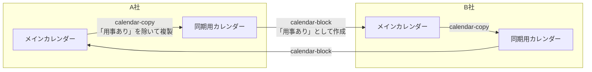

# sync_cal

2 社の Google カレンダーを使い分けているとき、片方の会社の予定をもう片方に「用事あり」として入れ、
他の人に予定を入れられないようにブロックする Apps Script。

## 仕組み

A 社と B 社にアカウントを持つとする。A 社の予定は B 社のカレンダーで「用事あり」に、
B 社の予定は A 社のカレンダーで「用事あり」になる。



| ディレクトリ | 内容 |
| --- | --- |
| `calendar-copy/` | 自社のメインカレンダーの予定を、同期用カレンダーへ複製する |
| `calendar-block/` | 相手の会社の同期用カレンダーの予定を、自社のメインカレンダーに「用事あり」として作成する |

### 同期用カレンダーを挟む理由

メインカレンダーを直接読むと、B 社の予定から A 社に作った「用事あり」が、A 社の予定として B 社へ送り返されてしまう。
calendar-copy は「用事あり」を除いて複製するので、同期用カレンダーには自社の予定だけが残る。
なお、欠席の返事をした予定と終日予定も複製しない。

### 同期の方式

どちらも `updateOneMonth`（30 日分）を時間主導型トリガー（15 分ごと）で実行する。
差分だけを作成・削除し、作成を先に行うので、途中で失敗してもブロックは抜けず、次の実行で揃う。

- calendar-copy は、同期用カレンダーの期間内の予定をすべて管理対象とする。同期用カレンダーには手で予定を入れない。
- calendar-block は、メインカレンダーの「用事あり」という件名の予定を管理対象とする。手で「用事あり」を入れると削除される。

## スクリプト プロパティ

カレンダー ID はコードに書かず、Web エディタの「プロジェクトの設定 → スクリプト プロパティ」に登録する。

| プロジェクト | プロパティ | 値 |
| --- | --- | --- |
| calendar-copy | `SOURCE_CALENDAR_ID` | 自社のメインカレンダー |
| calendar-copy | `TARGET_CALENDAR_ID` | 自社の同期用カレンダー |
| calendar-block | `MAIN_CALENDAR_ID` | 自社のメインカレンダー（「用事あり」を作成する） |
| calendar-block | `BLOCK_CALENDAR_ID` | 相手の会社の同期用カレンダー（自社のアカウントから読めるよう共有しておく） |

## 開発

各ディレクトリで [clasp](https://github.com/google/clasp) を使い、Apps Script のプロジェクトとコードをやり取りする。

### 準備

1. `npm install -g @google/clasp` で clasp をインストールする。
   Homebrew の clingo に含まれる `clasp` は、同じ名前の別のコマンド（解集合プログラミングのソルバー）である。
   PATH でそちらが先に見つかると、`clasp login` が `Can not read from 'login'` で失敗する。
   `which -a clasp` で確かめ、ぶつかる場合は `npx @google/clasp` で呼ぶ。
2. 配置先のアカウントで <https://script.google.com/home/usersettings> を開き、「Google Apps Script API」をオンにする。
3. `clasp login` でログインする。

### `.clasp.json` を作る

`.clasp.json` は、push する先のプロジェクトを指定するファイルである。
プロジェクトはアカウントごとに異なるので、リポジトリには含めない（`.gitignore` で除外している）。
`calendar-copy/` と `calendar-block/` のそれぞれに、次の内容で作る。

```json
{
  "scriptId": "<スクリプト ID>",
  "rootDir": ""
}
```

スクリプト ID は、Web エディタの「プロジェクトの設定 → ID」か、`clasp list-scripts` の URL で確認する。
プロジェクトがまだなければ、Web エディタで新しく作ってから ID を控える。

複数のアカウントで使うときは、`clasp login --user <名前>` でアカウントごとにログインする。
以降のコマンドにも、同じ `--user <名前>` を付ける。

### 反映する

```sh
clasp pull   # Web エディタの変更を取り込む（ローカルのファイルが上書きされるので git diff で確かめる）
clasp push   # リモートを上書きする（先に pull して差分が無いか確かめる）
```

push の前に、[スクリプト プロパティ](#スクリプト-プロパティ)を登録しておく。
未登録のまま push すると、次のトリガー実行から失敗する。
